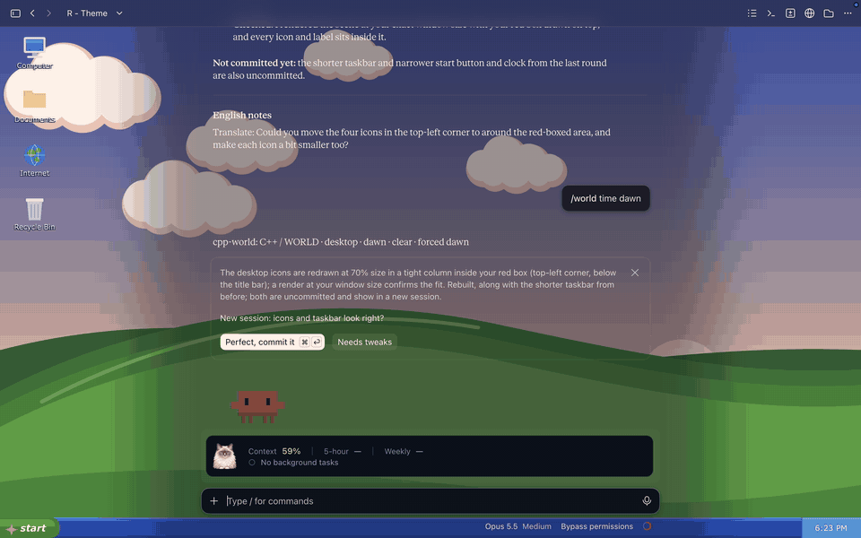

# claude-xp-theme

Plugin name: `retro-xp-theme`.


A theme mod for the **Claude desktop app** (Code tab): an animated retro early-2000s desktop behind your chat, with a live taskbar clock, time-of-day skies, weather, and a little orange pet. A second look, a pixel-art camping valley, is one command away. A compact card above the prompt shows your context and plan usage.



## Install

At the prompt of a Claude Code terminal session:

```
/plugin install retro-xp-theme --marketplace ribincao/claude-xp-theme
```

Answer `y` to add the marketplace, then pick a scope (user scope applies it everywhere). From a shell:

```bash
claude plugin install retro-xp-theme --marketplace ribincao/claude-xp-theme
```

In the desktop app, where `/plugin` does not run: click **+** next to the prompt box → **Plugins** → **Add marketplace** with `ribincao/claude-xp-theme` → **Add plugin**. Start a new session to see it.

> Themes draw in the desktop and mobile apps, not in the terminal.

## What you get

**Retro desktop (default look)**
- A bright sky over rolling green hills, puffy clouds drifting by, four desktop icons, and a blue taskbar with a **start** button and a **live clock**.
- Follows your local clock: dawn (05:00), day (08:00), dusk (17:00) with a sunset, night (19:30) with a moon and twinkling stars.
- Weather: rain greys the sky and falls in slanted layers; snow whitens the hills with drifting flakes.
- An orange pixel pet strolls across the meadow, carries an umbrella in the rain, and sits watching the moon at night.

**Pixel camp (`/world look camp`)**
- A 640×360 pixel-art valley with a tent, a flickering campfire with rising embers, a lantern, a stream, drifting clouds, birds by day and fireflies at dusk.
- The same times of day and weather, with the pet strolling, warming up by the fire, sheltering under an umbrella or tucked in the snow.

**Usage card above the prompt**
- `Context │ 5-hour │ Weekly` percentages (blue under 50 %, amber from 50 %, red from 80 %) and your background tasks (background shell commands and running agents).
- The plan limits show "—" until the session's first reply brings a reading.
- The card's avatar is C++, the author's cat.

## Commands

| Command | What it does |
|---|---|
| `/world` | Show the current look, time of day, weather and clock mode |
| `/world look desktop` / `/world look camp` | Switch looks |
| `/world time dawn\|day\|dusk\|night` | Force a time of day |
| `/world time now` | Back to your real clock |
| `/world weather clear\|rain\|snow` | Change the weather (`sun`, `sunny`, `rainy`, `snowy` work too) |
| `/world lapse 60` / `/world lapse off` | Watch a whole day pass every 60 seconds (minimum 20) |

Settings are remembered across sessions.

## Building your own

Everything is generated from two scripts (Node, no dependencies):

```bash
node tools/build-desktop.mjs   # retro desktop: hooks/scenes-desktop.ts
node tools/build-native.mjs    # pixel camp + the hooks/scenes.ts index
```

`preview/` holds every scene as a standalone SVG you can open in a browser.

### What actually animates in the desktop background

Found by testing on the Claude desktop app (Claude Code 2.1.325), and the reason these scenes are built the way they are:

- **Works:** flat-colour shapes, CSS `@keyframes` on `transform: translate(...)`, and SMIL `<animateTransform type="translate">` (smooth, or `calcMode="discrete"` for frame swaps).
- **Freezes the whole picture:** clip paths, masks, gradients, filters, any `opacity` (even static), `scale`/`rotate`, `transform-box`, and `shape-rendering="crispEdges"`.
- **Image backgrounds** (`backdrop: { image }`) and photos embedded in the SVG don't display.
- Don't redraw the background on a timer: each redraw restarts the animation. (The clock redraw here passes wall-clock-based negative delays so the clouds and pet carry on.)
- A scene must stay under 131,072 characters, and a hooks module under 1 MiB, so the scenes are split into one file per time of day.

## Credits

Original artwork, drawn in code. The retro desktop is a homage to early-2000s desktops; it doesn't use any Microsoft wallpaper, logo or font and isn't affiliated with Microsoft. The orange pet is a fan drawing; this project isn't affiliated with Anthropic.

## License

MIT
